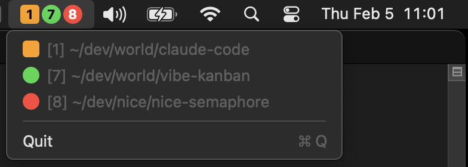

# Nice Semaphore

A macOS menu bar app that monitors running Claude Code instances and displays their status.



Be alerted when a Claude Code instance is working (orange), needs input (red), or when it's idle and needs new instructions (green).

> [!IMPORTANT]  
> This is alpha software that works on my machine. Don't install yet unless you have some time to spend debugging early release issues.

The current version is optimized for a workstation setup where:
* You're using multiple spaces, and have tend to keep one or a few Claude Code instances in each space
* You're running Claude Code CLI in iTerm2

## Features

- **Colored status indicators** - Colored boxes show each instance's state at a glance
- **Space numbers** - Shows which macOS Space each instance is on (if running in iTerm2)
- **Focus detection** - Highlights the currently focused instance (rounded square vs circle)
- **Real-time updates** - Status changes appear immediately via Claude Code hooks
- **History** - Append-only logs of every session's status changes and of which Space each session was on, for building timelines

## Status colors

| Status | Color | Meaning |
|--------|-------|---------|
| Working | Orange | Claude is processing/using tools |
| Waiting | Red | Claude needs your input (question or permission prompt) |
| Idle (new) | Yellow | Turn just completed, you haven't focused the terminal yet |
| Idle | Green | Turn complete, ready for next prompt |

Yellow automatically becomes green once you focus the terminal running that instance.

# How It Works

Nice Semaphore is split into pieces that communicate through files. Each piece owns its own current-state file and append-only event log, and depends only on the pieces before it:

| Piece | Knows | Writes | Depends on |
|-------|-------|--------|------------|
| Sessions (hook script + `NiceSemaphoreSessions`) | Which Claude Code sessions exist and what they're doing | `sessions/state.json`, `sessions/log.jsonl` | — |
| Spaces (`NiceSemaphoreSpaces`) | Which macOS Space each session is on | `spaces/state.json`, `spaces/log.jsonl` | Sessions |
| Menu bar app | How to show it | nothing | Sessions, Spaces |

All files live under `~/Library/Application Support/NiceSemaphore/`, or under `$NICE_SEMAPHORE_HOME` if set (set it in both Claude Code's environment and the app's).

### 1. Sessions

Claude Code [hooks](https://docs.anthropic.com/en/docs/claude-code/hooks) trigger shell commands on specific events. The `nice-semaphore-status.sh` hook script runs on each event and updates `sessions/state.json` with the current state of each Claude instance.

| Hook | Status Change |
|------|---------------|
| `SessionStart` | Adds instance, sets to **idle** |
| `UserPromptSubmit` | Sets to **working** |
| `PreToolUse` | If AskUserQuestion/ExitPlanMode, sets to **waiting** |
| `PostToolUse` | Ensures **working** state after tool completes |
| `Notification` | If permission prompt, sets to **waiting** |
| `Stop` | Sets to **idle** (turn complete) |
| `SessionEnd` | Removes instance |

The state file stores each running session's ID, project path, status, PID, and TTY (for focus and Space detection). An event for a session the state file doesn't know yet (for example after the file was reset) adds it.

Each change is also appended to `sessions/log.jsonl`, one JSON object per line. Lifecycle events (`SessionStart`, `UserPromptSubmit`, `SessionEnd`) are always logged; other events only when they change the status:

```json
{"v":1,"ts":"2026-10-26T14:03:12Z","sessionId":"3f2c…","event":"UserPromptSubmit","status":"working","prevStatus":"idle","cwd":"/Users/you/code/app","pid":51234,"tty":"/dev/ttys004"}
```

`SessionEnd` doesn't fire when Claude Code crashes or is killed, so the app removes sessions whose process is gone and logs a `reaped` event for them.

### 2. Spaces

The app finds each session's Space by matching its TTY to an iTerm2 window (AppleScript), then asking macOS which Space that window is on (private CGS APIs). The terminal step sits behind a `TerminalWindowResolver` protocol so other terminals can be added.

`spaces/state.json` holds each session's current Space. `spaces/log.jsonl` records an `enter` when a session is first seen on a Space and a `leave` when it moves away, ends, or can no longer be located:

```json
{"v":1,"ts":"2026-10-26T14:03:12Z","event":"enter","sessionId":"3f2c…","spaceId":42,"spaceIndex":3,"displayId":"37D8832A-…","cwd":"/Users/you/code/app"}
```

- `spaceId` is macOS's stable ID for the Space. `spaceIndex` is the number shown in the menu bar, counted across all displays; it changes when Spaces are reordered (without logging an event), so follow a Space over time by `spaceId`.
- `tracker_start` and `tracker_stop` records mark when the app was running. Spaces aren't observed between a `tracker_stop` and the next `tracker_start`.

For example, every session that was ever on Space ID 42:

```sh
jq -c 'select(.spaceId == 42)' ~/Library/Application\ Support/NiceSemaphore/spaces/log.jsonl
```

Logs rotate at 10 MB (`log-<timestamp>.jsonl`); rotated logs are kept.

### 3. Menu Bar App

The Swift app watches `sessions/state.json` using a `DispatchSource` file watcher. When the file changes, it:

1. Parses the JSON to get all active instances
2. Detects which instance is focused (by matching TTYs to the frontmost terminal window)
3. Updates the Space tracker
4. Renders colored indicators in the menu bar

The menu bar shows colored shapes with Space numbers. Click to see the full list with project paths.


# Installation

## Requirements

- macOS 13+
- Claude Code CLI
- iTerm2 (for focus detection)
- `jq` (usually pre-installed on macOS)

## Install manually via repo

### 1. Clone the repo

```sh
git clone https://github.com/nice-computer/nice-semaphore.git
cd nice-semaphore
```

### 2. Build

```sh
swift build -c release
```

If this fails with an SDK or toolchain error, install the latest Command Line Tools update (`softwareupdate --list`) or run `sudo xcode-select --reset`.

### 3. Install the hooks plugin

From inside a Claude Code session, add this repo as a plugin marketplace and install:

```
/plugin marketplace add /path/to/nice-semaphore
/plugin install nice-semaphore@nice-semaphore
```

Claude Code manages the hooks registration — no edits to `~/.claude/settings.json` are needed.

### 4. Run the app

```sh
swift run -c release
```

To run at login, add the binary to System Settings > General > Login Items:
```
.build/release/NiceSemaphore
```

### 5. Restart Claude Code instances

Because Claude Code only reloads hooks on startup, you'll need to restart any Claude Code instances you'd like tracked.

When upgrading from plugin version 0.1, update the plugin (`/plugin marketplace update nice-semaphore`) and restart your Claude Code instances too: 0.1 wrote to `~/.claude/nice-semaphore-status.json`. The app moves any live sessions it finds in that file into the new location and then deletes it.

You can resume an exited Claude Code session by running `claude --continue` in the same working directory.


## Install with homebrew

Coming soon.


# Uninstallation

From inside a Claude Code session:

```
/plugin uninstall nice-semaphore@nice-semaphore
/plugin marketplace remove nice-semaphore
```

Optionally delete the state files and logs: `~/Library/Application Support/NiceSemaphore/`.

# Roadmap

* Iron out bugs
* macOS app image
* Support terminals other than iTerm
* Support remote Claude Code instances
* Support other coding agents (Codex, Gemini, OpenCode, Aider, etc)

# Developing

## Requirements

* Homebrew
* ```sh
  brew install bats-core
  ```
* Xcode or the Command Line Tools (for `swift test`)

## Testing

Run the test suite:

```sh
make test
```

This runs both suites:

* `make test-hooks`: [Bats](https://github.com/bats-core/bats-core) tests for the hook script's state transitions and event log.
* `make test-swift`: XCTest tests for the `NiceSemaphoreSessions` and `NiceSemaphoreSpaces` libraries, including a contract test that runs the real hook script. The library tests don't touch AppKit or the Spaces APIs, so they also run on Linux.

## Debugging

### Enable hook logging

Set the `NICE_SEMAPHORE_DEBUG` environment variable in the terminal session before starting Claude Code:

```sh
export NICE_SEMAPHORE_DEBUG=1
claude
```

The hook script inherits the environment from the Claude Code process, so the variable must be set before `claude` starts. To enable permanently, add the export to your `~/.zshrc` or `~/.bashrc`.

Logs are written to `~/Library/Application Support/NiceSemaphore/debug.log`:

```sh
tail -f ~/Library/Application\ Support/NiceSemaphore/debug.log
```

### Inspect the state files and logs

```sh
cd ~/Library/Application\ Support/NiceSemaphore
jq . sessions/state.json   # running sessions
jq . spaces/state.json     # current Space of each session
tail -f sessions/log.jsonl spaces/log.jsonl
```

### Test the hook script manually

Simulate a hook event by running the script directly from the repo. Point `NICE_SEMAPHORE_HOME` at a scratch directory to keep test sessions out of your real state:

```sh
export NICE_SEMAPHORE_HOME=/tmp/nice-semaphore-test
echo '{"session_id": "test-123", "cwd": "/tmp/test", "hook_event_name": "SessionStart"}' | ./hooks/nice-semaphore-status.sh
```

### Verify the plugin is installed

From inside a Claude Code session:

```
/plugin list
```

The `nice-semaphore` plugin should appear as installed.

# Acknowledgments

* **[SpaceId](https://github.com/dshnkao/SpaceId/)**  
  A macOS menu bar app that shows the current Space number.
* **[yabai](https://github.com/asmvik/yabai)** and **[skhd](https://github.com/asmvik/skhd)**  
  for i3wm-like tiling window management on macOS, keyboard driven and space aware
* **[i3wm](https://i3wm.org/)**  
  The og X11 tiling window manager


# Sponsors

Thanks to:

* **[Nice Computer Company (nicecomputer.company)](https://nicecomputer.company/)** for sponsoring the coffee ☕️
* **[Autographical (autographical.ai)](https://autographical.ai/)** for the context engineering 🧠
